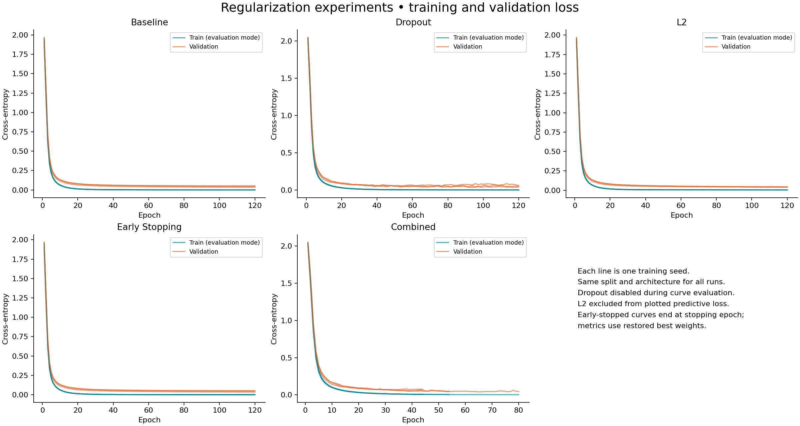
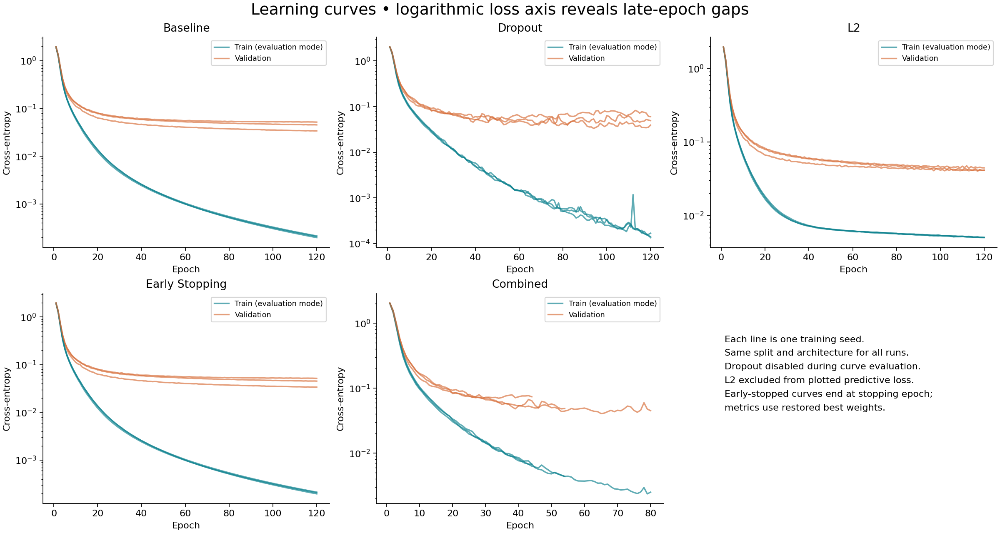
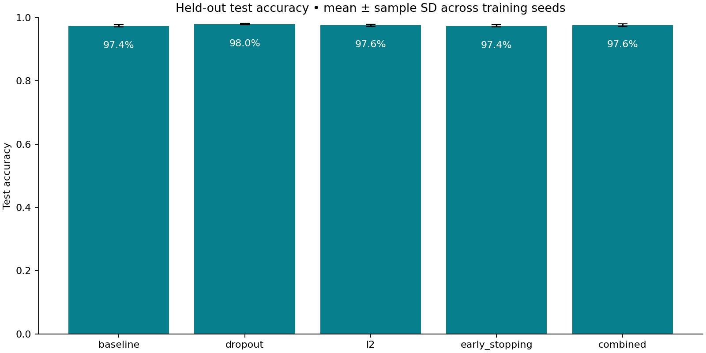
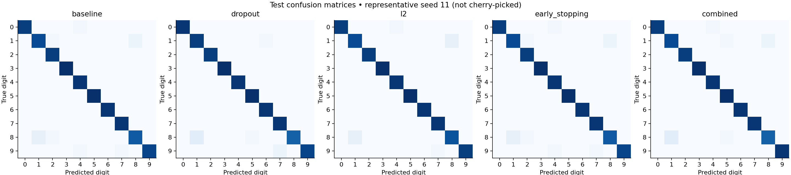

# Model validation and regularization report

## Protocol

Dataset: 1,797 handwritten digit images, 64 input pixels, 10 classes. Stratified split sizes: {'train': 1077, 'val': 360, 'test': 360}. No dataset was supplied, so the bundled digits dataset is used.
StandardScaler is fitted on training data only. A 64→128→64→10 ReLU network is trained with Adam (learning rate 0.001), batch size 64. Each variant uses the same split and paired initialization/shuffle seeds. No synthetic label noise is added.
Maximum epochs: 120; seeds: [11, 22, 33]. Dropout p=0.3. L2 objective: mean cross-entropy + (0.001/2) × sum of squared weight parameters; biases excluded. This is explicit L2, not AdamW decay. Early stopping uses validation CE, patience 15 and min_delta 0.0001, restoring the best checkpoint.
Hyperparameters were specified before inspecting test results. Only the regularization method is compared; this is not an exhaustive hyperparameter search. Baseline, dropout-only and L2-only use final-epoch weights; early stopping variants use restored weights.

## Results

| Variant | Validation CE | Test CE | Test accuracy | Test macro F1 | Val−train CE gap |
|---|---:|---:|---:|---:|---:|
| baseline | 0.0437 ± 0.0091 | 0.1177 ± 0.0084 | 0.9741 ± 0.0032 | 0.9735 ± 0.0032 | 0.0435 ± 0.0091 |
| dropout | 0.0497 ± 0.0105 | 0.0934 ± 0.0258 | 0.9796 ± 0.0016 | 0.9791 ± 0.0015 | 0.0496 ± 0.0105 |
| l2 | 0.0424 ± 0.0018 | 0.0661 ± 0.0017 | 0.9759 ± 0.0032 | 0.9756 ± 0.0034 | 0.0373 ± 0.0018 |
| early_stopping | 0.0438 ± 0.0090 | 0.1174 ± 0.0084 | 0.9741 ± 0.0032 | 0.9735 ± 0.0032 | 0.0436 ± 0.0091 |
| combined | 0.0527 ± 0.0149 | 0.0736 ± 0.0134 | 0.9759 ± 0.0042 | 0.9754 ± 0.0043 | 0.0435 ± 0.0092 |

Values are mean ± sample SD across training seeds on one fixed split; these are not confidence intervals or independent test sets.

## Interpretation

**Validation-selected variant: l2.** This choice was locked using mean validation cross-entropy before the test evaluation. Test results are reported for all variants as requested, but do not change the selection.
The baseline mean validation-minus-training CE gap is 0.0435. A growing gap with falling training loss and flattening/rising validation loss is evidence of overfitting; a gap alone does not establish the best stopping point. Inspect the full curves rather than accuracy alone.
The highest mean test accuracy belongs to dropout (97.96%). L2 test CE is 0.0661, compared with baseline 0.1177. This illustrates why classification accuracy and probability-sensitive loss can favor different choices.
Early-stopping-only runs executed [120, 120, 120] epochs; combined runs executed [54, 44, 80]. Reaching the epoch budget means the patience rule did not trigger, not that early stopping is broken. Baseline curves flatten at low validation loss, so these runs do not demonstrate a dramatic late-epoch validation-loss explosion.
Dropout makes hidden activations unavailable during training; L2 penalizes large weights. Either can reduce variance but can also underfit if too strong. Early stopping limits training duration and returns the best validation checkpoint. Regularization is not guaranteed to improve every metric or every seed.
For this comparison, prefer the validation-selected variant when predictive log-loss matters. Accuracy and macro F1 provide complementary classification views. The dataset is small and random splits may share handwriting characteristics; this does not establish performance for new writers or production images. Repeat with writer-separated data and an untouched external test set before deployment.

## Visuals

## References

- https://scikit-learn.org/stable/modules/generated/sklearn.datasets.load_digits.html
- https://docs.pytorch.org/docs/stable/generated/torch.nn.Dropout.html
- https://docs.pytorch.org/docs/stable/generated/torch.optim.Adam.html